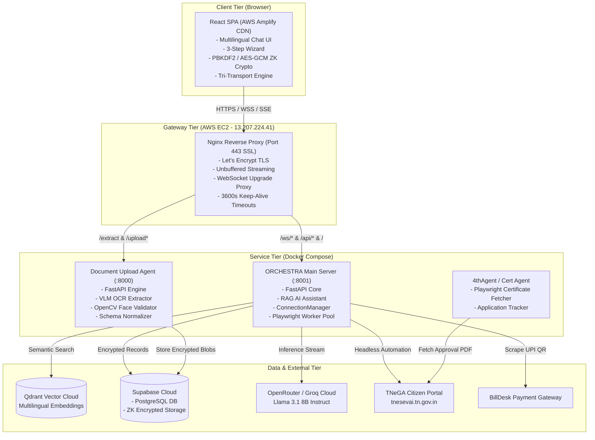
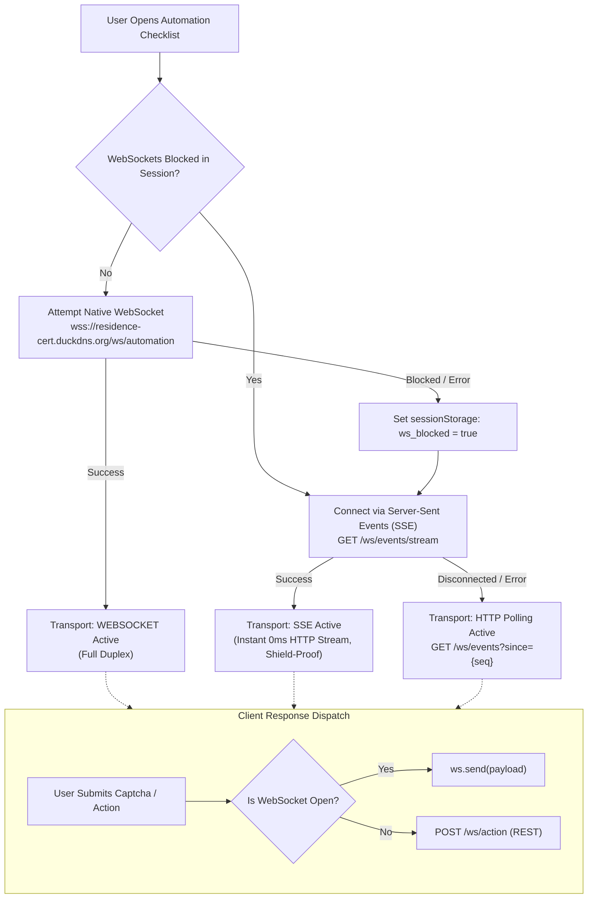
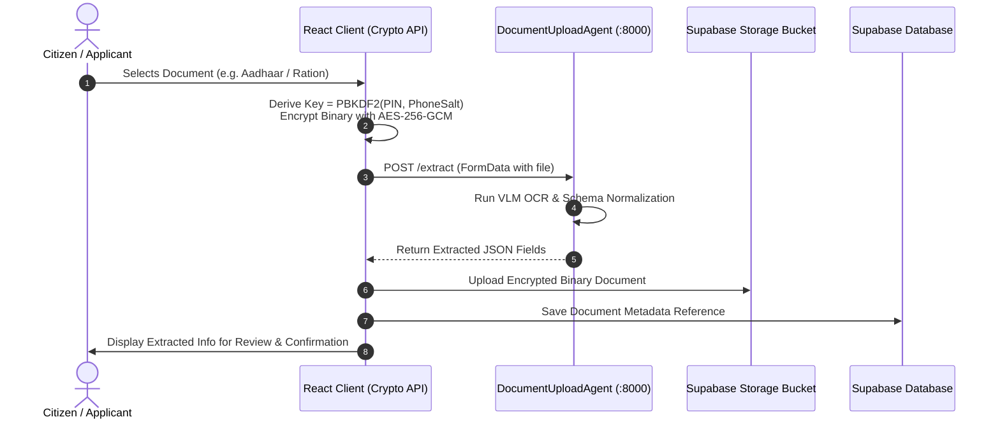
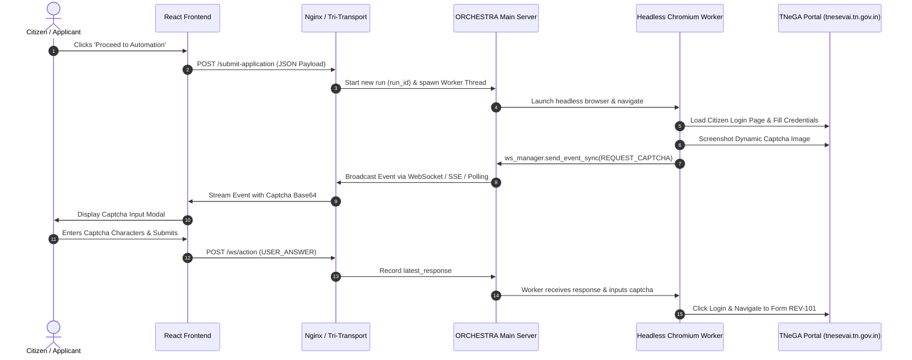
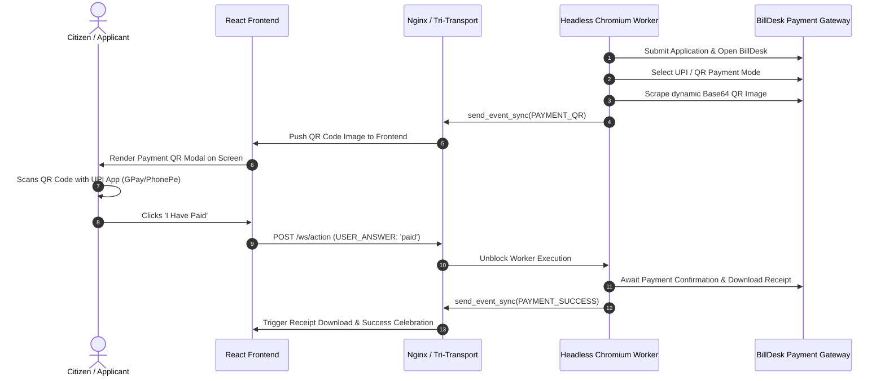

# Level 2: System Architecture Document (SAD)

## 1. System Architecture Overview

The system is engineered as a **distributed, microservice-oriented platform** consisting of a React Single-Page Application (SPA) deployed on AWS Amplify, a hardened Nginx reverse proxy gateway, and multiple containerized backend microservices deployed on an AWS EC2 instance.

---

## 2. Architectural Layers

### Layer 1: Client Tier (Frontend)
- **Framework**: React 18 with Vite.
- **Hosting**: AWS Amplify with global CDN edge caching.
- **State Management**: React Hooks (`useCallback`, `useRef`, `useState`) with local/session persistence.
- **Client-Side Cryptography**: Web Crypto API (`window.crypto.subtle`) for deterministic PBKDF2 key derivation and AES-GCM-256 encryption.
- **Real-Time Client**: Smart Tri-Transport engine that dynamically transitions across WebSocket, Server-Sent Events (SSE), and HTTP Long-Polling.

### Layer 2: Gateway Tier (Reverse Proxy)
- **Server**: Nginx 1.24+ running on Ubuntu 24.04 LTS (`13.207.224.41`).
- **TLS Termination**: Let's Encrypt SSL certificate for `residence-cert.duckdns.org`.
- **Routing Rules**:
  - `location ^~ /ws/`: Proxied to port `8001` with `Upgrade` and `Connection` header forwarding, `proxy_buffering off;`, and `tcp_nodelay on;`.
  - `location ~ ^/(extract|upload|verify)`: Proxied to port `8000` with 20MB client payload limits.
  - `location /`: Proxied to port `8001` with 3600s timeouts for long-running workflows.

### Layer 3: Microservices Tier (Backend)
1. **ORCHESTRA Main Server** (Container: `orchestra-backend`, Port 8001):
   - Core API handling chat streaming, OTP services, and application submission.
   - `ConnectionManager`: Multi-transport pub-sub hub managing event queues, event sequencing, run IDs, and client responses.
   - Playwright Worker: Autonomous headless browser executor driving citizen portal interactions.
2. **Document Upload Agent** (Container: `document-upload-agent`, Port 8000):
   - Microservice specialized in document ingestion, VLM-powered OCR extraction, field normalization, and OpenCV face validation.
3. **Certificate Agent (`4thAgent`)**:
   - Specialized worker script to query portal records by transaction ID and retrieve issued certificate PDFs.

### Layer 4: Storage & Cloud Services Tier
- **Supabase Cloud**:
  - PostgreSQL tables: `user_chat_history`, `user_profiles`, `user_documents`, `application_payloads`.
  - S3-compatible Object Storage Bucket: `documents` for zero-knowledge encrypted binary uploads.
- **Qdrant Vector Cloud**:
  - Dedicated vector database hosting embeddings of official TNeGA service definitions and legal rules.
- **LLM Inference Providers**:
  - OpenRouter & Groq hosting `meta-llama/llama-3.1-8b-instruct`.

---

## 3. Real-Time Tri-Transport Architecture

To prevent disconnections caused by browser ad-blockers, tracking protection, or corporate proxy firewalls, the real-time layer employs a **three-tier fallback hierarchy**:

---

## 4. Key Sequence & Data Flow Workflows

### Workflow 1: Zero-Knowledge Client-Side Document Ingestion

### Workflow 2: Autonomous Portal Automation & Captcha Handshake

### Workflow 3: BillDesk Payment Facilitation & Receipt Extraction

---

## 5. Security Architecture

### Zero-Knowledge Principles
1. **Client-Side Key Generation**: PBKDF2 (100,000 rounds of SHA-256) is executed exclusively inside the browser's Web Crypto runtime.
2. **Ciphertext-Only Ingestion**: Cloud databases and storage buckets store only initialization vectors (IV) and AES-256-GCM ciphertexts.
3. **No Key Storage**: Neither backend servers nor Supabase ever receive or persist the citizen's decryption key or PIN.

### Network & Infrastructure Hardening
- **TLS 1.3 / 1.2 Enforcement**: Strict SSL configuration via Let's Encrypt certificates.
- **CORS Protection**: Explicit origin allowlists ensuring API endpoints only accept requests from the designated AWS Amplify production domains and local development origins.
- **Isolation via Docker**: Backend microservices communicate over an internal Docker bridge network (`orchestra_default`), with only ports 8000 and 8001 exposed locally to Nginx on `127.0.0.1`.
