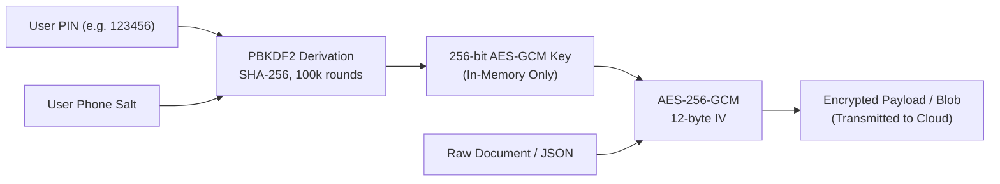
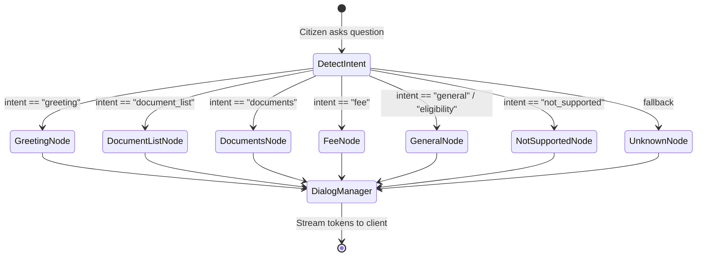

# Level 3: Technical Codebase Reference

## 1. Introduction & Source Tree Overview

This document provides an exhaustive, code-level technical reference for the **TNeGA Residence Certificate AI Assistant & Autonomous Agent**. It details every component, microservice, class, function, database schema, API route, and deployment configuration across the repository.

### Repository Tree

```
RES_CERT/
├── docs/                                  # Multi-tier system documentation
│   ├── README.md                          # Documentation index and overview
│   ├── 01-requirements.md                 # Level 1: System Requirements Specification (SRS)
│   ├── 02-architecture.md                 # Level 2: System Architecture Document (SAD)
│   └── 03-technical.md                    # Level 3: Technical Codebase Reference (This document)
├── ORCHESTRA/                             # Primary application workspace
│   ├── deploy.sh                          # Automated EC2 Docker deployment & systemd script
│   ├── docker-compose.yml                 # Multi-container orchestration (ports 8000, 8001)
│   ├── render.yaml                        # Alternative Cloud PaaS deployment manifest
│   ├── frontend/                          # Client-Side React SPA (AWS Amplify)
│   │   ├── index.html                     # HTML5 entry point & viewport meta
│   │   ├── package.json                   # NPM dependencies (React 18, Vite, Lucide, Tailwind)
│   │   ├── vite.config.js                 # Vite bundling configuration & dev proxy
│   │   ├── amplify.yml                    # AWS Amplify CI/CD pipeline buildspec
│   │   └── src/
│   │       ├── main.jsx                   # Application bootstrap & i18n mounting
│   │       ├── App.jsx                    # Root state controller & tri-transport router
│   │       ├── i18n.js                    # Multilingual translation dictionary (EN / TA)
│   │       ├── index.css                  # Global Tailwind & design system styling
│   │       ├── api/
│   │       │   └── chatApi.js             # REST API client & streaming fetch wrapper
│   │       ├── utils/
│   │       │   └── crypto.js              # Client-Side PBKDF2 & AES-256-GCM zero-knowledge crypto
│   │       ├── components/
│   │       │   ├── DocumentChecklist.jsx  # 3-step application wizard & live execution status
│   │       │   ├── DocumentUpload.jsx     # Encrypted multi-document uploader
│   │       │   ├── AutomationModal.jsx    # Live portal automation viewer & captcha prompt
│   │       │   ├── PaymentModal.jsx       # Dynamic UPI QR code modal & BillDesk verifier
│   │       │   ├── OtpModal.jsx           # Phone verification dialog via MessageCentral
│   │       │   ├── SelfDeclarationModal.jsx # Declaration PDF preview & digital signer
│   │       │   ├── ReceiptView.jsx        # Post-submission acknowledgment & receipt viewer
│   │       │   ├── DocumentNumberModal.jsx # Extracted document identifier confirmation
│   │       │   ├── ChatBubble.jsx         # Conversational message bubble with Markdown support
│   │       │   ├── ChatInput.jsx          # Input bar with voice input & submit trigger
│   │       │   ├── AppSidebar.jsx         # Navigation drawer & session action controls
│   │       │   ├── AppStatusView.jsx      # System microservice health dashboard
│   │       │   ├── AgentStatus.jsx        # Agent execution timeline indicator
│   │       │   ├── ContactView.jsx        # E-Sevai contact & support channels
│   │       │   ├── FaqView.jsx            # Frequently Asked Questions accordion
│   │       │   └── ui/                    # Animated visual UI primitives (shaders, morphing)
│   └── ORCHESTRA/                         # Backend Microservices Root
│       ├── ORCHESTRA/                     # Main Backend Service (Port 8001)
│       │   ├── app.py                     # FastAPI server, ConnectionManager, API endpoints
│       │   ├── agent.py                   # LangGraph RAG workflow, Qdrant retrieval, LLM streaming
│       │   ├── guardrails.py              # In-scope domain validation & prompt injection defenses
│       │   ├── otp_service.py             # MessageCentral CPaaS OTP delivery integration
│       │   ├── sarvam_service.py          # Sarvam AI Indic language translation service
│       │   ├── redis_cache.py             # Upstash Redis distributed caching client
│       │   ├── supabase_db.py             # Supabase PostgreSQL client & masked phone indexing
│       │   ├── ingest.py                  # Knowledge base chunking & Qdrant vector indexing
│       │   ├── face_validator.py          # OpenCV Haar cascade face validator utility
│       │   ├── doc_app.py                 # Standalone document verification service
│       │   ├── Dockerfile                 # Container build spec for main backend service
│       │   ├── pdf_documents/             # Authoritative TNeGA legal & service rule PDFs
│       │   └── Playwright/                # Autonomous Portal Driver
│       │       ├── rescert.py             # Main Playwright script for Residence Certificate
│       │       ├── main.py                # Standalone automation runner
│       │       ├── delete_saved_app.py    # Portal draft cleanup utility
│       │       └── Self_Declaration_Form_For_User.pdf # Base template for self-declaration
│       ├── DocumentUploadAgent/           # Document Ingestion Microservice (Port 8000)
│       │   ├── app.py                     # FastAPI document upload, extraction & verification API
│       │   ├── extractor.py               # Vision-Language Model (VLM) & regex field extractor
│       │   ├── validator.py               # Cross-document consistency verification engine
│       │   ├── face_validator.py          # Photo face detection & quality validator
│       │   ├── supabase_db.py             # Encrypted S3 bucket document persistence
│       │   ├── config.py                  # Environment settings & API keys
│       │   ├── utils.py                   # Image transformation & PDF preprocessing utilities
│       │   └── Dockerfile                 # Container build spec for DocumentUploadAgent
│       └── 4thAgent/                      # Certificate Retrieval Microservice
│           ├── cert_agent.py              # Headless Playwright script for certificate retrieval
│           ├── CERTTOOL.py                # Certificate download tool definition
│           └── main.py                    # Standalone certificate retrieval executor
├── README.md                              # Repository overview & quick start
├── requirements.txt                       # Consolidated Python dependencies
└── residence-cert.nginx                   # Nginx reverse proxy configuration for port 443 SSL
```

---

## 2. Client Tier: Frontend Architecture

The frontend is a single-page application built with **React 18** and **Vite**, deployed on **AWS Amplify**.

### 2.1 Core Application State Controller (`src/App.jsx`)
[App.jsx](file:///home/devaprasath/Documents/RES_CERT/ORCHESTRA/frontend/src/App.jsx) is the master coordinator for user interaction, session state, navigation, and real-time streaming.

- **Key State Variables**:
  - `activeTab`: Controls the main view (`"home"`, `"checklist"`, `"status"`, `"faq"`, `"contact"`).
  - `messages`: Array of chat message objects (`[{ id, sender, text, timestamp }]`).
  - `sessionId`: Unique UUID v4 identifying the active user session.
  - `phoneNumber` & `userPin`: Credentials for zero-knowledge key derivation.
  - `automationStatus`: Lifecycle status of Playwright execution (`"idle"`, `"running"`, `"waiting_captcha"`, `"waiting_otp"`, `"waiting_payment"`, `"completed"`, `"error"`).
  - `transportMode`: Real-time indicator (`"ws"`, `"sse"`, `"polling"`, `"shield_blocked"`).
- **Tri-Transport Orchestration Logic**:
  1. Inspects `sessionStorage.getItem("tnega_ws_blocked")`.
  2. If clean, attempts native `WebSocket` connection to `wss://residence-cert.duckdns.org/ws/automation`.
  3. If blocked by client tracker shield (`ERR_BLOCKED_BY_CLIENT`), marks session as blocked and initiates `EventSource` on `GET /ws/events/stream`.
  4. If `EventSource` disconnects, smoothly degrades to HTTP polling on `GET /ws/events?since={seq}` every 1000ms.
- **Action Dispatcher (`sendAutomationAction`)**:
  - Dispatches user answers (captcha text, OTP code, payment confirmation) via active WebSocket if open.
  - Concurrently issues a fallback REST `POST /ws/action` payload: `{"action": action_type, "value": value}` to guarantee zero lost interactions under broken WebSocket connections.

### 2.2 Zero-Knowledge Cryptography Engine (`src/utils/crypto.js`)
[crypto.js](file:///home/devaprasath/Documents/RES_CERT/ORCHESTRA/frontend/src/utils/crypto.js) implements deterministic client-side encryption using the standard **W3C Web Crypto API** (`window.crypto.subtle`).



- **Key Derivation (`deriveUserKey(phoneNumber, pin)`)**:
  - Derives an `AES-GCM` 256-bit key from the user's PIN, using the normalized 10-digit phone number as the cryptographic salt.
  - Uses `PBKDF2` with `SHA-256` hash and `100,000` iterations.
  - Employs an in-memory `KEY_MEMORY_CACHE` to avoid repeated expensive PBKDF2 calculations during user sessions.
- **Functions**:
  - `encryptPayloadZK(text, phoneNumber, pin)`: Encrypts plaintext JSON strings; returns base64 string formatted as `{iv_b64}:{ciphertext_b64}`.
  - `decryptPayload(payload, phoneNumber, pin)`: Unpacks IV and ciphertext, decrypts using the derived key, and outputs plaintext.
  - `encryptDocumentBytesZK(fileArrayBuffer, phoneNumber, pin)`: Prepends a fresh 12-byte initialization vector (`crypto.getRandomValues(new Uint8Array(12))`) to the ciphertext bytes of identity PDFs/images.
  - `decryptDocumentBytesZK(encryptedArrayBuffer, phoneNumber, pin)`: Slices the leading 12-byte IV and decrypts binary payloads in-browser before preview or rendering.

### 2.3 Application Wizard (`src/components/DocumentChecklist.jsx`)
[DocumentChecklist.jsx](file:///home/devaprasath/Documents/RES_CERT/ORCHESTRA/frontend/src/components/DocumentChecklist.jsx) provides a 3-step structured wizard that guides citizens through pre-requisite verification before starting automation:

- **Step 1: Portal & CAN Verification**:
  - Fields: TNeGA Citizen Login Username, Password, Applicant CAN Number, Name, Father/Husband Name, Gender, District, Taluk, Village, Street Address, and PIN code.
  - Includes input masking and format validation for the 13-digit CAN number (`^\d{13}$`).
- **Step 2: Residency Period**:
  - Custom popover calendar selecting "Residing Since" date and "Residing Until" date.
  - Validates that the "Residing Since" date precedes the "Residing Until" date.
- **Step 3: Document Checklist & Upload**:
  - Manages required attachments:
    1. Applicant Photograph (`applicant_photo`).
    2. Any Address Proof (`address_proof`: Ration Card, Aadhaar Card, Driving License, or Passport).
    3. Self-Declaration Form (`self_declaration`).
  - Calls `DocumentUploadAgent` for OCR extraction and OpenCV face validation.
- **Real-Time Automation Dashboard**:
  - Displays live step indicators as the headless browser executes:
    `Initiating` -> `Logging In` -> `Captcha Check` -> `CAN Search` -> `Form Filling` -> `Document Upload` -> `Payment Gateway` -> `Receipt Generated`.
  - Integrates the live transport indicator badge: `● REAL-TIME: WEBSOCKET`, `● REAL-TIME: SSE`, or `● REAL-TIME: POLLING`.

### 2.4 Modal Interaction Dialogs
- **[AutomationModal.jsx](file:///home/devaprasath/Documents/RES_CERT/ORCHESTRA/frontend/src/components/AutomationModal.jsx)**:
  - Dynamically renders portal captchas streamed as base64 images from the Playwright runner.
  - Provides a "Refresh Captcha" button that dispatches `{"action": "captcha_refresh"}` to the headless worker.
  - Provides an input field to submit the solved captcha string.
- **[PaymentModal.jsx](file:///home/devaprasath/Documents/RES_CERT/ORCHESTRA/frontend/src/components/PaymentModal.jsx)**:
  - Renders the dynamic UPI QR code scraped from the TNeGA BillDesk payment gateway.
  - Displays a countdown timer and instructions for UPI payment (GPay, PhonePe, Paytm).
  - Emits the `"payment_done"` signal when the user taps "I Have Completed Payment".
- **[OtpModal.jsx](file:///home/devaprasath/Documents/RES_CERT/ORCHESTRA/frontend/src/components/OtpModal.jsx)**:
  - Dispatches mobile verification requests to `/api/send-otp` and validates 6-digit verification codes via `/api/verify-otp`.
- **[SelfDeclarationModal.jsx](file:///home/devaprasath/Documents/RES_CERT/ORCHESTRA/frontend/src/components/SelfDeclarationModal.jsx)**:
  - Allows citizens to preview the auto-generated Self-Declaration PDF and electronically sign or upload a signed copy.

---

## 3. Main Backend Service (`ORCHESTRA/ORCHESTRA/ORCHESTRA/`)

The primary backend microservice is built using **FastAPI** and operates on port `8001`.

### 3.1 Application Entry & Real-Time Hub (`app.py`)
[app.py](file:///home/devaprasath/Documents/RES_CERT/ORCHESTRA/ORCHESTRA/ORCHESTRA/app.py) handles all HTTP routing, conversational streams, OTP dispatch, and real-time client communication.

#### The `ConnectionManager` Class
`ConnectionManager` provides unified event multicasting across WebSockets, SSE streams, and polling queues:
- `active_connections: List[WebSocket]`: Pool of active full-duplex WebSocket sockets.
- `_events: deque(maxlen=200)`: Sliding window of sequenced automation events (`_seq: int`).
- `_run_id: str`: Unique execution run identifier generated per automation session. Prevents stale events (e.g. past payment modals) from leaking into subsequent runs.
- `_pending_responses: Dict[str, asyncio.Future]`: Holds awaiting futures for synchronous Playwright automation steps requiring human input.

#### Primary Endpoints
| Endpoint | Method | Description |
| :--- | :--- | :--- |
| `/` | `GET`, `HEAD` | Microservice health check. |
| `/chat` | `POST` | Primary RAG conversational AI endpoint (synchronous response). |
| `/chat/stream` | `POST` | Streaming RAG endpoint via Server-Sent Events (SSE). |
| `/ws/automation` | `WebSocket` | Full-duplex WebSocket channel for browser automation. |
| `/ws/events/stream` | `GET` | SSE real-time stream (`text/event-stream`) for shield-blocked clients. |
| `/ws/events` | `GET` | HTTP polling endpoint accepting `?since={seq}` query parameter. |
| `/ws/action` | `POST` | Ingestion endpoint for human actions (captchas, OTPs, payments). |
| `/ws/diagnostic` | `GET` | Real-time connection diagnostic reporting active channels and event queue length. |
| `/submit-application` | `POST` | Ingests application payload and launches the Playwright automation thread. |
| `/delete-saved-application` | `POST` | Spawns cleanup worker to delete pending portal drafts. |
| `/api/send-otp` | `POST` | Dispatches SMS OTP using MessageCentral CPaaS. |
| `/api/verify-otp` | `POST` | Verifies submitted OTP code against verification ID. |
| `/api/chat-history` | `GET`, `DELETE` | Retrieves or clears zero-knowledge encrypted chat messages in Supabase. |
| `/download-declaration` | `GET` | Downloads generated Self-Declaration PDF. |
| `/upload-signed-declaration`| `POST` | Uploads user-signed Self-Declaration PDF. |

### 3.2 LangGraph RAG Agent Workflow (`agent.py`)
[agent.py](file:///home/devaprasath/Documents/RES_CERT/ORCHESTRA/ORCHESTRA/ORCHESTRA/agent.py) orchestrates the conversational AI assistant using **LangGraph** and vector search over **Qdrant Cloud**.



- **State Schema (`RAGState`)**:
  - `question: str`: The input query.
  - `intent: Dict`: Classified primary and secondary intents.
  - `context: List[str]`: Semantic text chunks retrieved from Qdrant.
  - `applicant_category: Optional[str]`: User category (`"individual"`, `"student"`, `"migrant"`).
  - `chat_history: List[Dict]`: Context history for multi-turn dialogue.
  - `stage: Optional[str]`: Active dialogue step.
  - `answer: Optional[str]`: Synthesized response.
- **Vector Retrieval (`retrieve_chunks`)**:
  - Converts user queries into 1024-dimensional dense vectors using OpenRouter/Nvidia embedding models.
  - Performs Cosine similarity search against Qdrant collection `residence_certificate_docs` with score thresholding.
- **Inference Fallback**:
  - Primary LLM: `meta-llama/llama-3.1-8b-instruct` on OpenRouter.
  - Secondary LLM: Groq Cloud API with automatic key rotation across 6 backup keys (`GROQ_API_KEY1` through `GROQ_API_KEY6`).

### 3.3 Guardrail Enforcement Engine (`guardrails.py`)
[guardrails.py](file:///home/devaprasath/Documents/RES_CERT/ORCHESTRA/ORCHESTRA/ORCHESTRA/guardrails.py) acts as a high-speed pre-execution filter to enforce domain boundaries and prevent jailbreaks.

- **Topic Whitelisting**:
  - RegEx rules (`_IN_SCOPE_KEYWORDS`) validate that conversations focus strictly on Residence Certificates, TNeGA, e-Sevai, CAN registration, address proof, or payment.
- **Out-of-Scope Blacklisting**:
  - Rejects queries related to general coding, entertainment, unrelated government certificates (Caste, Income, First Graduate), politics, or mathematics.
- **Refusal Response**:
  - Returns friendly bilingual refusal messages in Tamil and English without invoking costly cloud LLMs:
    > *"I specialize only in TNeGA Residence Certificate services. For other certificates, please visit the official e-Sevai portal."*

### 3.4 SMS OTP Integration (`otp_service.py`)
[otp_service.py](file:///home/devaprasath/Documents/RES_CERT/ORCHESTRA/ORCHESTRA/ORCHESTRA/otp_service.py) integrates with the **MessageCentral CPaaS** platform:
- `send_otp(mobile_number, country_code="91")`: Generates transaction ID and triggers SMS delivery via `https://cpaas.messagecentral.com/verification/v3/send`.
- `verify_otp(mobile_number, code, verification_id)`: Validates the 6-digit OTP against the verification ID.
- Fallback Mode: If `MESSAGE_CENTRAL_AUTH_TOKEN` is unset, activates an in-memory mock store permitting `123456` for staging test runs.

### 3.5 Database & Storage Client (`supabase_db.py`)
[supabase_db.py](file:///home/devaprasath/Documents/RES_CERT/ORCHESTRA/ORCHESTRA/ORCHESTRA/supabase_db.py) handles PostgreSQL transactions and encrypted file persistence on Supabase:
- **Phone Number Masking**:
  - Uses `_mask_phone(phone)` to hash phone numbers with SHA-256 before storage (`user_hash`), preventing plaintext PII indexing.
- **Tables Managed**:
  - `user_chat_history`: Stores encrypted chat messages (`encrypted_content`, `role`, `timestamp`, `session_id`).
  - `user_profiles`: Stores applicant category, draft stage, and preference parameters.
  - `application_payloads`: Stores the encrypted JSON application structure ready for Playwright execution.
- **Object Storage Bucket**:
  - Bucket `document_uploads`: Holds encrypted binary blobs of uploaded certificates.

### 3.6 Playwright Automation Engine (`Playwright/rescert.py`)
[rescert.py](file:///home/devaprasath/Documents/RES_CERT/ORCHESTRA/ORCHESTRA/ORCHESTRA/Playwright/rescert.py) contains the complete automation logic driving the TNeGA citizen portal (`tnesevai.tn.gov.in`).

- **Class `TNeSevaiBackendAgent`**:
  - Handles the end-to-end browser automation lifecycle.
  - **Headless Detection**: Automatically runs headless in cloud/EC2/Docker environments (`should_run_headless()`) and headed on local machines with active displays.
  - **Portal Navigation Flow**:
    1. **Login**: Navigates to `https://tnesevai.tn.gov.in/Citizen/`. Enters portal username and password.
    2. **Captcha Capture**: Screenshots the login captcha element, base64 encodes it, and emits a `captcha_prompt` event to `ConnectionManager`.
    3. **Human In The Loop**: Suspends automation execution via `asyncio.Future` until the user submits the solved captcha via WebSocket or REST `/ws/action`.
    4. **Service Navigation**: Traverses the e-Sevai departmental directory: *Revenue Department* -> *REV-101: Residence Certificate*.
    5. **CAN Lookup**: Inputs the 13-digit CAN number, triggers record search, selects the applicant radio button, and generates portal OTP.
    6. **Application Form Filling**:
      - Populates applicant name, relationship (Father/Husband), and residential address in Tamil and English.
      - Injects the residency duration dates into form fields (`#txtResidingFrom`, `#txtResidingTo`).
    7. **Document Upload**:
      - Uploads applicant photo, address proof document, and self-declaration form.
      - Sets mandatory dropdown types and document serial numbers.
    8. **Self-Declaration Signing**:
      - Downloads the portal's dynamic Self-Declaration PDF.
      - Generates digital signature or collects signed upload from user.
      - Uploads signed PDF back to portal attachments table.
    9. **Payment Gateway Scraping**:
      - Clicks Submit, navigates to the BillDesk payment gateway.
      - Captures dynamic UPI QR code, base64 encodes it, and emits a `payment_qr` event.
      - Waits for citizen payment confirmation signal (`"payment_done"`).
    10. **Receipt Capture**:
      - Verifies transaction success page, downloads the official acknowledgment receipt PDF, and takes a high-resolution screenshot.

---

## 4. Document Ingestion Microservice (`ORCHESTRA/ORCHESTRA/DocumentUploadAgent/`)

The `DocumentUploadAgent` runs on port `8000` and specializes in document parsing, OCR extraction, and image validation.

### 4.1 Service API Router (`app.py`)
[app.py](file:///home/devaprasath/Documents/RES_CERT/ORCHESTRA/ORCHESTRA/DocumentUploadAgent/app.py) provides endpoints for file processing:
- `POST /extract`: Ingests an uploaded document (PDF/Image), classifies document type, and extracts structured fields using Vision-Language Models.
- `POST /verify/photo`: Runs OpenCV face detection on uploaded photo files.
- `POST /process-all`: Orchestrates multi-file batch extraction and cross-document validation.
- `POST /upload-encrypted-doc`: Stores client-encrypted document blobs directly into Supabase S3 storage.

### 4.2 Multi-Modal Extraction Engine (`extractor.py`)
[extractor.py](file:///home/devaprasath/Documents/RES_CERT/ORCHESTRA/ORCHESTRA/DocumentUploadAgent/extractor.py) combines Vision-Language Models (VLM) with deterministic regex parsers:
- **VLM Pipeline (`run_vlm`)**:
  - Uses `meta-llama/llama-3.2-11b-vision-instruct` via Nvidia NIM or Groq Vision.
  - Automatically rotates across multiple fallback API keys upon rate-limiting (`429` / `503`).
- **Deterministic Parsers**:
  - `_extract_aadhaar_from_text(text)`: Extracts 12-digit Aadhaar number (`\b\d{4}\s\d{4}\s\d{4}\b`), DOB, and father's name.
  - `_extract_dl_from_text(text)`: Extracts Driving License number, issue date, and validity.
  - `_extract_ration_from_text(text)`: Extracts Tamil Nadu Smart Card / Ration Card number and family head name.
  - `_extract_pan_from_text(text)`: Extracts 10-character PAN string (`[A-Z]{5}[0-9]{4}[A-Z]{1}`).

### 4.3 Cross-Document Validation Engine (`validator.py`)
[validator.py](file:///home/devaprasath/Documents/RES_CERT/ORCHESTRA/ORCHESTRA/DocumentUploadAgent/validator.py) checks consistency across uploaded identity proofs:
- `calculate_pairwise_similarity(doc1, doc2, name1, name2)`: Uses Levenshtein distance and token similarity algorithms to match names and addresses across different documents.
- `compute_confidence(validation)`: Computes an aggregate confidence score (0.0 to 1.0). If confidence falls below 0.65, flags fields for manual user confirmation.

### 4.4 Face Validation Module (`face_validator.py`)
[face_validator.py](file:///home/devaprasath/Documents/RES_CERT/ORCHESTRA/ORCHESTRA/DocumentUploadAgent/face_validator.py) validates applicant photographs:
- Uses OpenCV's `haarcascade_frontalface_default.xml` classifier.
- For PDF inputs, extracts the embedded raster image stream using `pypdf` or converts page 1 to 150 DPI via `pdf2image`.
- Verifies that exactly one human face is present, rejecting landscape photos, blank files, or multi-person group images.

---

## 5. Certificate Retrieval Microservice (`ORCHESTRA/ORCHESTRA/4thAgent/`)

The `4thAgent` microservice tracks submitted applications and retrieves approved certificates.

### 5.1 Headless Certificate Fetcher (`cert_agent.py` & `CERTTOOL.py`)
[cert_agent.py](file:///home/devaprasath/Documents/RES_CERT/ORCHESTRA/ORCHESTRA/4thAgent/cert_agent.py) implements post-submission tracking:
- Class `TNeGACertificateDownloader`:
  - Logs into the portal using citizen credentials.
  - Navigates to *Check Status / Download Certificate*.
  - Inputs the Application / Transaction ID.
  - When approved by the Revenue Inspector / Tahsildar, clicks the download link to retrieve the digitally signed Residence Certificate PDF.
  - Saves the certificate to `Downloaded_Certificates/{Application_Number}.pdf`.

---

## 6. Real-Time Tri-Transport Protocol Specification

The real-time communication pipeline connects the headless browser on EC2 with the citizen's browser.

```mermaid
sequenceDiagram
    autonumber
    actor User as Citizen Browser (Amplify)
    participant Nginx as EC2 Nginx (:443)
    participant Backend as FastAPI Main (:8001)
    participant Playwright as Headless Chromium

    User->>Nginx: Connect WebSocket (wss://.../ws/automation)
    alt Shield Blocks WebSocket (ERR_BLOCKED_BY_CLIENT)
        Nginx--xUser: Blocked by Client Shield
        User->>Nginx: Fallback: GET /ws/events/stream (SSE)
        Nginx->>Backend: Forward SSE Stream (Buffering Off)
        Backend-->>User: HTTP 200 text/event-stream (Connected)
    else WebSocket Permitted
        Nginx->>Backend: Upgrade: websocket
        Backend-->>User: WS 101 Switching Protocols
    end

    User->>Backend: POST /submit-application (Payload)
    Backend->>Playwright: Spawn Worker Thread
    Playwright->>Playwright: Navigate tnesevai.tn.gov.in
    Playwright->>Backend: Captcha Encountered (Screenshot)
    Backend->>User: Event: {"type": "captcha_prompt", "image": "data:image/png;base64,..."}
    User->>User: User enters captcha in modal
    User->>Backend: POST /ws/action {"action": "captcha_solution", "value": "AB12"}
    Backend->>Playwright: Resolve Awaiting Future
    Playwright->>Playwright: Submit Captcha & Proceed
```

### Event Payload Formats

#### 1. Captcha Prompt Event (`captcha_prompt`)
Sent by the backend when the portal login captcha is displayed:
```json
{
  "type": "captcha_prompt",
  "_seq": 14,
  "_run_id": "run_9f2a8c1",
  "data": {
    "image": "data:image/png;base64,iVBORw0KGgoAAAANSUhEUgAA...",
    "prompt": "Please enter the captcha shown above"
  }
}
```

#### 2. Human Action Submission (`POST /ws/action` or WebSocket message)
Sent by the client to deliver the solved value:
```json
{
  "action": "captcha_solution",
  "value": "W8X2Y"
}
```

#### 3. Payment QR Event (`payment_qr`)
Sent by the backend when the BillDesk UPI payment screen is reached:
```json
{
  "type": "payment_qr",
  "_seq": 28,
  "_run_id": "run_9f2a8c1",
  "data": {
    "qr_image": "data:image/png;base64,iVBORw0KGgoAAAANSUhEUgAA...",
    "amount": "60.00",
    "service": "REV-101: Residence Certificate",
    "expiry_seconds": 300
  }
}
```

#### 4. Payment Confirmation Action
Sent by the client after completing the UPI transaction:
```json
{
  "action": "payment_done",
  "value": "confirmed"
}
```

---

## 7. Database & Storage Schemas

### 7.1 PostgreSQL Tables (Supabase)

#### Table: `user_chat_history`
| Column | Type | Constraints | Description |
| :--- | :--- | :--- | :--- |
| `id` | `uuid` | Primary Key, `default gen_random_uuid()` | Unique record identifier. |
| `user_hash` | `text` | Indexed | SHA-256 hashed user phone number. |
| `session_id` | `text` | Indexed | Client session identifier. |
| `role` | `text` | Not Null | Message author (`"user"` or `"assistant"`). |
| `encrypted_content`| `text` | Not Null | AES-256-GCM ciphertext (`{iv}:{ciphertext}`). |
| `stage` | `text` | Nullable | Dialogue flow stage. |
| `created_at` | `timestamptz` | `default now()` | Timestamp of insertion. |

#### Table: `user_profiles`
| Column | Type | Constraints | Description |
| :--- | :--- | :--- | :--- |
| `id` | `uuid` | Primary Key, `default gen_random_uuid()` | Record identifier. |
| `user_hash` | `text` | Unique, Indexed | Hashed phone identifier. |
| `encrypted_profile`| `text` | Not Null | Zero-knowledge encrypted user details JSON. |
| `applicant_category`| `text`| Nullable | Extracted category (`"individual"`). |
| `updated_at` | `timestamptz` | `default now()` | Last update timestamp. |

#### Table: `application_payloads`
| Column | Type | Constraints | Description |
| :--- | :--- | :--- | :--- |
| `id` | `uuid` | Primary Key, `default gen_random_uuid()` | Unique submission identifier. |
| `user_hash` | `text` | Indexed | Hashed phone identifier. |
| `encrypted_payload`| `text` | Not Null | Encrypted full application JSON. |
| `status` | `text` | Default `'pending'` | Lifecycle status (`'pending'`, `'processing'`, `'completed'`). |
| `application_number`| `text`| Nullable | TNeGA issued transaction number. |
| `created_at` | `timestamptz` | `default now()` | Submission timestamp. |

---

## 8. Environment Variables Reference

| Variable Name | Required | Default | Service | Description |
| :--- | :---: | :---: | :---: | :--- |
| `PORT` | Yes | `8001` / `8000` | All | HTTP port the FastAPI server binds to. |
| `HEADLESS` | No | `true` | Main / 4thAgent | Forces headless browser mode in cloud/Docker environments. |
| `ALLOWED_ORIGINS` | Yes | `*` | All | Comma-delimited list of permitted CORS web origins. |
| `OPEN_ROUTER_API_KEY` | Yes | None | Main | OpenRouter API token for RAG inference and vector embeddings. |
| `QDRANT_URL` | Yes | None | Main | Qdrant Cloud cluster endpoint URL. |
| `QDRANT_API_KEY` | Yes | None | Main | Qdrant Cloud authentication API key. |
| `GROQ_API_KEY` | Yes | None | DocAgent / Main | Primary Groq token for VLM OCR and Llama-3 inference. |
| `GROQ_API_KEY1`..`KEY6` | No | None | DocAgent / Main | Backup Groq tokens for automated failover rotation. |
| `NVIDIA_API_KEY` | No | None | DocAgent | Primary Nvidia NIM token for VLM OCR extraction. |
| `NVIDIA_API_KEY1`..`KEY3`| No | None | DocAgent | Secondary Nvidia NIM tokens for rotation. |
| `SUPABASE_URL` | Yes | None | All | Supabase project REST API endpoint URL. |
| `SUPABASE_KEY` | Yes | None | All | Supabase service-role or anon API key. |
| `UPSTASH_REDIS_REST_URL`| No | None | Main | Upstash Redis REST URL for distributed caching. |
| `UPSTASH_REDIS_REST_TOKEN`| No | None | Main | Upstash Redis REST bearer token. |
| `MESSAGE_CENTRAL_AUTH_TOKEN`| No| None | Main | MessageCentral CPaaS authentication token for SMS OTP. |
| `MESSAGE_CENTRAL_CUSTOMER_ID`| No| None | Main | MessageCentral CPaaS customer ID. |
| `ENCRYPTION_SECRET_KEY` | Yes | None | All | Server-side cryptographic fallback secret. |

---

## 9. DevOps & Production Runbook

### 9.1 EC2 Server Configuration
- **Host IP**: `13.207.224.41`
- **Domain**: `residence-cert.duckdns.org`
- **Operating System**: Ubuntu 24.04 LTS
- **Runtime**: Docker Engine 27+, Docker Compose v2, Nginx 1.24+

### 9.2 Managing Docker Containers
```bash
# Navigate to deployment directory
cd /home/ubuntu/RES_CERT/ORCHESTRA

# View real-time status of microservices
sudo docker compose ps

# View live service logs
sudo docker compose logs -f --tail=100 orchestra
sudo docker compose logs -f --tail=100 document-upload

# Rebuild and restart microservices with zero-downtime
sudo docker compose down
sudo docker compose up -d --build
```

### 9.3 Nginx Gateway Management
The Nginx reverse proxy configuration resides at `/etc/nginx/sites-available/residence-cert.nginx`.

```bash
# Test Nginx syntax
sudo nginx -t

# Gracefully reload configuration without dropping connections
sudo systemctl reload nginx

# Inspect Nginx access and error logs
sudo tail -f /var/log/nginx/access.log
sudo tail -f /var/log/nginx/error.log
```

### 9.4 SSL Certificate Renewal (Let's Encrypt)
Certbot handles TLS certificate renewals automatically via cron:
```bash
# Test automatic renewal dry-run
sudo certbot renew --dry-run
```
