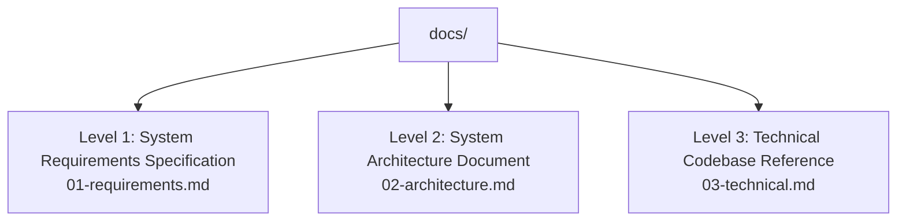

# TNeGA Residence Certificate AI Assistant & Automation System Documentation

Welcome to the official three-tier technical documentation for the **TNeGA Residence Certificate AI Assistant & Autonomous Agent**.

This documentation suite is organized across three hierarchical levels to serve diverse stakeholders—from government officials and product managers to systems architects and full-stack software engineers.

---

## Documentation Navigation

| Level | Document | Primary Target Audience | Core Coverage |
| :---: | :--- | :--- | :--- |
| **Level 1** | **[01-requirements.md](file:///home/devaprasath/Documents/RES_CERT/docs/01-requirements.md)** | Product Owners, Government Stakeholders, Business Analysts, End-Users | Executive summary, problem statements, functional requirements (FR), non-functional requirements (NFR), compliance, user personas, and success metrics. |
| **Level 2** | **[02-architecture.md](file:///home/devaprasath/Documents/RES_CERT/docs/02-architecture.md)** | Solution Architects, DevOps Engineers, Security Reviewers | System topology, client-server data flows, client-side zero-knowledge encryption model, Tri-Transport real-time streaming engine (WS / SSE / Polling), Docker microservice topology, and cloud integrations. |
| **Level 3** | **[03-technical.md](file:///home/devaprasath/Documents/RES_CERT/docs/03-technical.md)** | Core Developers, Backend & Frontend Engineers, Site Reliability Engineers | File-by-file codebase reference, React hooks and components, Web Crypto API algorithms, LangGraph RAG workflows, Playwright portal drivers, FastAPI route schemas, database DDLs, environment variables, and production deployment runbooks. |

---

## System Overview at a Glance

- **Application Purpose**: Automates the application, verification, document handling, and payment flow for Revenue Department Residence Certificates (*குடியிருப்புச் சான்றிதழ்*) on the Tamil Nadu e-Governance Agency (TNeGA) Citizen Portal (`tnesevai.tn.gov.in`).
- **Client Tier**: React 18 SPA hosted on AWS Amplify CDN featuring bilingual conversational guidance (English / Tamil) and a 3-step application wizard.
- **Privacy Model**: Zero-Knowledge (ZK) client-side encryption. User identity documents (Aadhaar, Ration Card, Driving License, Photo) are encrypted using PBKDF2-derived AES-256-GCM keys directly in the browser before reaching cloud storage.
- **Real-Time Engine**: Shield-proof Tri-Transport pipeline dynamically switching between native WebSocket (`wss://`), Server-Sent Events (`text/event-stream`), and HTTP Polling (`/ws/events`), completely immune to browser ad-blockers and privacy shields.
- **Automation Engine**: Containerized Headless Playwright Chromium driver running on AWS EC2, with real-time human-in-the-loop interactions for portal captchas, OTPs, and BillDesk UPI payments.
- **Microservices Topology**: Docker Compose stack terminating at an unbuffered Nginx 1.24+ SSL reverse proxy gateway on AWS EC2 (`13.207.224.41`).

---

## Quick Links to Key Source Files

### Frontend (Client-Side)
- **[App.jsx](file:///home/devaprasath/Documents/RES_CERT/ORCHESTRA/frontend/src/App.jsx)**: Main state controller, tab switcher, and Tri-Transport fallback coordinator.
- **[crypto.js](file:///home/devaprasath/Documents/RES_CERT/ORCHESTRA/frontend/src/utils/crypto.js)**: Web Crypto API zero-knowledge encryption and PBKDF2 key derivation.
- **[DocumentChecklist.jsx](file:///home/devaprasath/Documents/RES_CERT/ORCHESTRA/frontend/src/components/DocumentChecklist.jsx)**: 3-step wizard and real-time execution progress dashboard.
- **[chatApi.js](file:///home/devaprasath/Documents/RES_CERT/ORCHESTRA/frontend/src/api/chatApi.js)**: Backend communication client and SSE stream reader.

### Backend Microservices
- **[app.py](file:///home/devaprasath/Documents/RES_CERT/ORCHESTRA/ORCHESTRA/ORCHESTRA/app.py)**: Main FastAPI server, `ConnectionManager` event sequencer, and REST routes.
- **[agent.py](file:///home/devaprasath/Documents/RES_CERT/ORCHESTRA/ORCHESTRA/ORCHESTRA/agent.py)**: LangGraph RAG conversational AI assistant and Qdrant vector retrieval.
- **[rescert.py](file:///home/devaprasath/Documents/RES_CERT/ORCHESTRA/ORCHESTRA/ORCHESTRA/Playwright/rescert.py)**: Headless Playwright browser automation driver for TNeGA e-Sevai.
- **[extractor.py](file:///home/devaprasath/Documents/RES_CERT/ORCHESTRA/ORCHESTRA/DocumentUploadAgent/extractor.py)**: Vision-Language Model (VLM) OCR document extraction engine.
- **[validator.py](file:///home/devaprasath/Documents/RES_CERT/ORCHESTRA/ORCHESTRA/DocumentUploadAgent/validator.py)**: Cross-document identity and address consistency validator.
- **[cert_agent.py](file:///home/devaprasath/Documents/RES_CERT/ORCHESTRA/ORCHESTRA/4thAgent/cert_agent.py)**: Post-submission portal tracker and certificate retriever.

### Infrastructure & Deployment
- **[residence-cert.nginx](file:///home/devaprasath/Documents/RES_CERT/residence-cert.nginx)**: Nginx reverse proxy configuration for SSL termination, WebSocket upgrades, and unbuffered SSE streams.
- **[docker-compose.yml](file:///home/devaprasath/Documents/RES_CERT/ORCHESTRA/docker-compose.yml)**: Multi-container Docker deployment specification.
- **[deploy.sh](file:///home/devaprasath/Documents/RES_CERT/ORCHESTRA/deploy.sh)**: EC2 automated deployment script.
